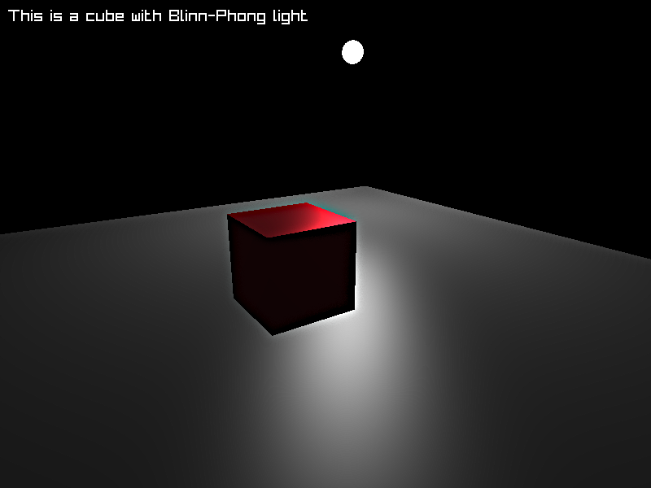
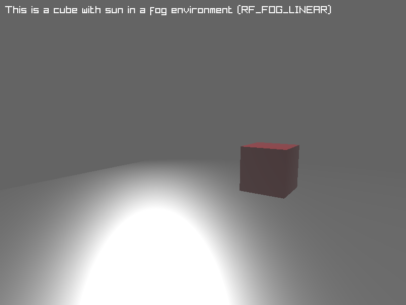
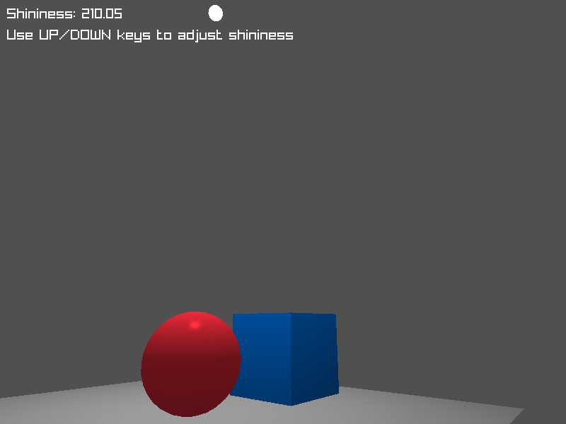
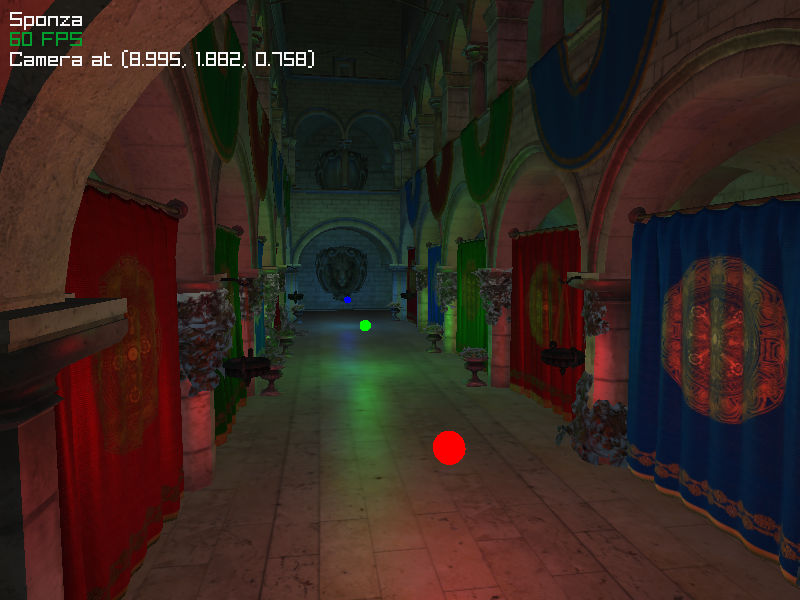

# RSF3D (Raylib Shader Forward 3D)

## Information:
- This library is a lightweight, easy-to-use 3d shader helper for raylib.
- Latest version: 0.5.2.

## Features:
- 2 shading models: Blinn-Phong and Gouraud.
- 3 types of lights: point, directional and spot lights.
- 3 types of fogs: linear, exponential and exponential squared fog.
- Can set the shininess.
- Skybox.

## Requirements:
- raylib version: 5.5+.
- C standard: C99+.
- OpenGL version: 3.3+.

## How to use and learn:
Use: This library is just a C header-only, no binary files, so you just attach it with your projects.
Learn: There are 2 ways to learn:
1. Read the examples.
2. Read the source code to understand how it works, especially shaders.

## Example:
```c
#include "rsf3d.h"

int main(void)
{
    InitWindow(800, 600, "basic light");
    SetTargetFPS(60);
    DisableCursor();

    Camera3D camera = {0};
    camera.position = (Vector3){5.0f, 5.0f, 5.0f};
    camera.fovy = 60.0f;
    camera.projection = CAMERA_PERSPECTIVE;
    camera.target = (Vector3){0.0f, 0.0f, 0.0f};
    camera.up = (Vector3){0.0f, 1.0f, 0.0f};

    Shader shader = RF_InitShader(); // default shading model is Blinn-Phong, shininess is 32.0f

    RF_Light light = RF_CreateLightPoint((Vector3){-3.0f, 3.0f, -3.0f}, 
        (Color){15,15,15,255}, (Color){100,100,100,255}, WHITE, 3.0f);
    RF_UpdateLightIntoBuffer(&light, 0); // Be in the loop if the light's data is changed a lot

    while (!WindowShouldClose())
    {
        UpdateCamera(&camera, CAMERA_FREE);

        RF_UpdateShader(shader, camera);

        BeginDrawing();
            ClearBackground(BLACK);

            BeginMode3D(camera);

                BeginShaderMode(shader);

                    DrawPlane((Vector3){0.0f, 0.0f, 0.0f}, (Vector2){10.0f, 10.0f}, GRAY);
                    DrawCube((Vector3){0.0f, 0.5f, 0.0f}, 1.0f, 1.0f, 1.0f, RED);

                EndShaderMode();

                DrawSphere(light.position, 0.2f, light.specular);

            EndMode3D();

            DrawText("This is a cube with Blinn-Phong light", 10, 10, 20, WHITE);

        EndDrawing();
    }

    RF_UnloadShader(shader); // shader must be the same as the one returned by RF_InitShader()

    CloseWindow();

    return 0;
}
```

## Warnings:
- If you want a deferred renderer, advanced lightings, SSAO, blooms, etc..., this library may not be for you. You can try: [R3D - Bigfoot71](https://github.com/Bigfoot71/r3d).

## License:
- Licensed under the MIT License. You can see [LICENSE](LICENSE).

## Images:



